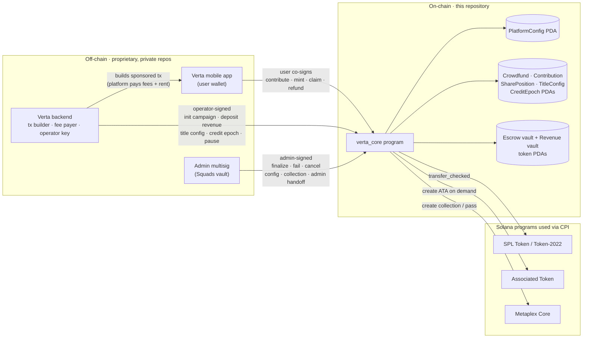
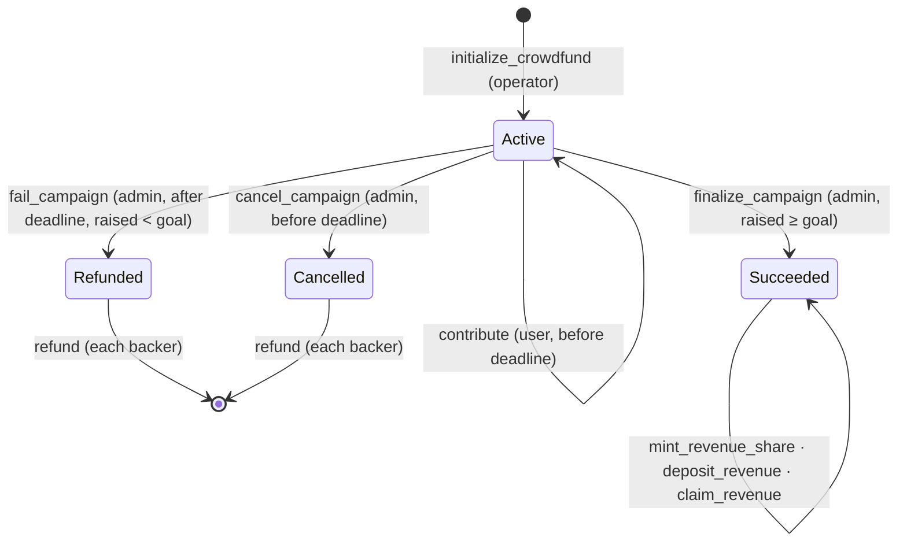
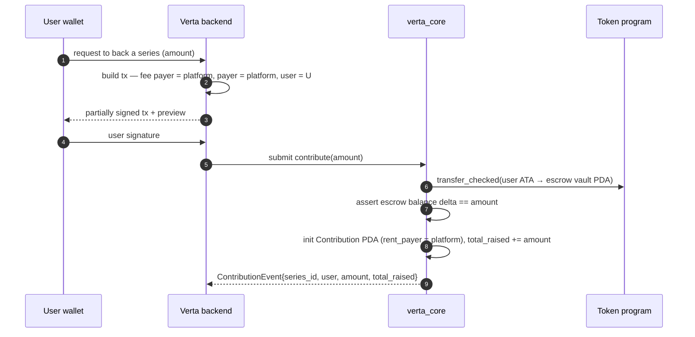

<div align="center">

# Verta — Solana Programs

**On-chain settlement layer for Verta, a mobile-first platform for premium vertical microdramas.**

[Website](https://www.verta.xyz/) · [X / Twitter](https://x.com/watchverta)

[](https://github.com/verta-hq/programs/actions/workflows/ci.yml)


[](LICENSE)

</div>

---

## Overview

[Verta](https://www.verta.xyz/) brings short-form, scripted vertical drama to a mobile-native audience, built for Solana Mobile. Viewers watch serialized episodes on their phones; creators and studios publish series and get paid.

Solana is where the money and ownership live. This repository contains **`verta_core`**, the Anchor program that lets fans **fund a series before it is produced, receive a transferable on-chain Revenue Share Pass, and claim their share of that series' revenue in USDC**. It also holds the platform's on-chain authority model, per-title royalty split records, and a daily public checkpoint of Verta's in-app coin economy.

| | |
|---|---|
| **Program** | `verta_core` |
| **Program ID** | [`A3CuYy9r2tpU4BafDSEbasuvFJAG3Nvet8oKAv6J1Pzr`](https://explorer.solana.com/address/A3CuYy9r2tpU4BafDSEbasuvFJAG3Nvet8oKAv6J1Pzr?cluster=devnet) |
| **Deployed** | Solana **devnet** (upgradeable). Not deployed to mainnet-beta. |
| **Framework** | Anchor 0.32.2 · Rust 1.89 · Metaplex Core 0.11 · SPL Token + Token-2022 |
| **Client** | Solana Kit client generated with Codama from the IDL |
| **Tests** | 29 integration tests on a local validator, run by CI on every PR and push to `main` |
| **Audit** | **Not audited** |

---

## Hackathon Submission

### What to evaluate in this repository

This repository is the **complete source of Verta's on-chain logic**. Everything that moves value on-chain on Verta's behalf, or that the platform commits to publicly, is defined here:

1. **USDC crowdfunding escrow.** A campaign for a series holds backer funds in a program-owned token vault until the campaign succeeds (funds go to production), fails or is cancelled (backers are refunded).
2. **Revenue Share Passes.** These are Metaplex Core NFTs in a single platform collection. Each pass is backed by a program-owned `SharePosition` PDA that records the holder's share of the series' backer revenue.
3. **Revenue distribution.** O(1) accumulator accounting: any number of passes can claim against any number of revenue deposits with no iteration over holders. Revenue follows the pass when it is sold.
4. **Split authorities.** A cold multisig **admin** and a hot **operator** have distinct, minimal powers. The program also has a pause switch and a two-step admin handoff.
5. **Gas sponsorship.** Every user-facing instruction separates the `user` signer from the `payer`, so the platform can pay fees and rent while the user only signs for their own tokens.
6. **Coin-economy checkpoint.** Once a day, a `CreditEpoch` account publicly anchors the aggregate figures of Verta's off-chain coin ledger.

### What is *not* in this repository

The Verta mobile app, backend API, admin dashboard and creator studio are **proprietary and maintained in separate private repositories**. This repository does not represent the entire Verta application. The README describes how those components *call* the program only as far as is needed to explain the on-chain design; their implementation is out of scope.

| Layer | Component | In this repo |
|---|---|:---:|
| On-chain | `verta_core` Anchor program, IDL, Codama client generator, test suite, deploy ceremony script | ✅ |
| Off-chain | Mobile app (Flutter, Solana Mobile Wallet Adapter / embedded wallets) | — |
| Off-chain | Backend API (transaction building, fee sponsorship, settlement, indexing) | — |
| Off-chain | Admin dashboard and creator studio | — |

---

## Architecture



**Signers.** Three kinds of keys interact with the program, and each instruction requires exactly one of them (plus an optional fee payer):

| Role | Holder | Signs |
|---|---|---|
| **User** | Viewer's wallet | `contribute`, `mint_revenue_share`, `claim_revenue`, `refund` (own funds only) |
| **Operator** | Platform hot key held by the backend | Routine operations: `initialize_crowdfund`, `deposit_revenue`, `create/update_title_config`, `record_credit_epoch`, `pause` |
| **Admin** | Multisig vault in the production design | Decisions that release funds or change authority: `finalize/fail/cancel_campaign`, `update_platform_config`, `propose_admin`, `create_revenue_share_collection` |

> On the current **devnet** deployment, `admin`, `operator` and the upgrade authority are the same development key (see [Security](#security)). The separation is enforced by the program and covered by tests. Moving `admin` to a multisig is a deployment step.

### Campaign lifecycle



### Sponsored transaction flow (example: contribute)



The user's wallet only authorizes moving its own USDC. The platform pays the transaction fee and the `Contribution` account rent, and the program records who paid that rent so a later `refund` returns it to the right party.

---

## On-Chain Program: `verta_core`

Source: [`programs/verta_core/src/`](programs/verta_core/src). It has 18 instructions, 6 account types, 1 event and 28 custom errors. The canonical IDL is [`idl/verta_core.json`](idl/verta_core.json).

### Accounts and PDAs

| Account | Seeds | Purpose |
|---|---|---|
| `PlatformConfig` | `["platform_authority"]` | Singleton: `admin`, `pending_admin`, `operator`, `settlement_mint`, `revenue_share_collection`, `paused`. Also update authority of the Core collection and signer for pass mints. |
| `TitleConfig` | `["title_config", title_id]` | Per-series royalty split record: `creator_wallet`, `creator_bps` + `platform_bps` (must sum to 10,000), `active` |
| `Crowdfund` | `["crowdfund", series_id]` | Campaign state: goal, deadline, `total_raised`, `production_wallet`, `backer_revenue_bps`, status, revenue accumulator, bound collection and mint |
| Escrow vault | `["escrow_vault", crowdfund]` | Token account (authority = crowdfund PDA) holding contributions until finalize or refund |
| Revenue vault | `["revenue_vault", crowdfund]` | Token account (authority = crowdfund PDA) holding the backer share of revenue only |
| `Contribution` | `["contribution", crowdfund, user]` | Per-backer total, `rent_payer` (sponsor), `minted` flag |
| `SharePosition` | `["position", asset]` | Authoritative payout record for a Revenue Share Pass: `crowdfund`, `asset`, `share_bps`, `claimed_checkpoint` |
| `CreditEpoch` | `["credit_epoch", epoch_day (u32 LE)]` | Daily coin-economy checkpoint: sold / spent / refunded totals, USD liability, `balances_root`, timestamp |

Every PDA has a matching helper in the generated client (`findPlatformConfigPda`, `findCrowdfundPda`, `findSharePositionPda`, …), added by [`scripts/generate-clients.js`](scripts/generate-clients.js).

### Instructions

**Admin and platform** ([`instructions/admin.rs`](programs/verta_core/src/instructions/admin.rs))

| Instruction | Signer | Behavior |
|---|---|---|
| `initialize_platform(admin, operator)` | Program **upgrade authority** | Creates `PlatformConfig` and pins the settlement mint. The payer must match `ProgramData.upgrade_authority_address`, which prevents a front-run initialization. |
| `update_platform_config(new_operator?, paused?)` + optional `new_settlement_mint` | Admin | Rotates the operator, changes the settlement mint, and is the **only way to unpause** |
| `pause` | Operator **or** admin | Emergency stop for every money-moving instruction |
| `propose_admin(new_admin)` → `accept_admin` | Admin → pending admin | Two-step handoff. The new key must prove control by signing. |

**Series** ([`instructions/series.rs`](programs/verta_core/src/instructions/series.rs))

| Instruction | Signer | Behavior |
|---|---|---|
| `create_title_config(title_id, creator_wallet, creator_bps, platform_bps, active)` | Operator | Registers a title's split. `title_id` is 1–32 bytes and the bps must sum to 10,000. |
| `update_title_config(...)` | Operator | Partial update. A split change requires both bps values and is re-validated. |

**Crowdfunding and revenue** ([`instructions/crowdfunding.rs`](programs/verta_core/src/instructions/crowdfunding.rs))

| Instruction | Signer | Pause-gated | Behavior |
|---|---|:---:|---|
| `create_revenue_share_collection` | Admin | | One-time creation of the global "Verta Revenue Shares" Core collection, with `PlatformConfig` as update authority |
| `initialize_crowdfund(series_id, goal, deadline, production_wallet, backer_revenue_bps)` | Operator | ✅ | Validates the parameters, requires the settlement mint, and creates the escrow and revenue token PDAs |
| `contribute(amount)` | User (+ sponsor payer) | ✅ | Moves USDC from the user's account to escrow before the deadline and records `rent_payer`. Emits `ContributionEvent`. |
| `finalize_campaign` | Admin | ✅ | Requires `total_raised ≥ goal`. Drains escrow to the production wallet's ATA (created on demand) and snapshots the accumulator. |
| `fail_campaign` | Admin | | Allowed after the deadline when the goal was missed. Status → `Refunded`. |
| `cancel_campaign` | Admin | | Allowed **before** the deadline only. Status → `Cancelled`. |
| `refund` | User | ✅ | Pays the user's full contribution back from escrow, decrements `total_raised`, and closes `Contribution` with its rent returned to `rent_payer` |
| `mint_revenue_share` | User (+ sponsor payer) | ✅ | Allowed once per contribution. Mints a Core asset into the collection, signed by the `PlatformConfig` PDA, and writes the `SharePosition`. |
| `deposit_revenue(amount)` | Operator | ✅ | Splits the deposit: the backer portion goes to the revenue vault and bumps the accumulator; the remainder goes to the production ATA |
| `claim_revenue` | Current pass owner (+ sponsor payer) | ✅ | Verifies on-chain Core ownership and pays the accrued share to the owner's ATA (created on demand) |

**Credits** ([`instructions/credits.rs`](programs/verta_core/src/instructions/credits.rs))

| Instruction | Signer | Behavior |
|---|---|---|
| `record_credit_epoch(epoch_day, coins_sold, coins_spent, coins_refunded, usd_liability_micro, balances_root)` | Operator | Writes one PDA per UTC day (`init_if_needed`, so re-running a day overwrites idempotently). This is a public, timestamped commitment of the off-chain coin ledger. |

### How it fits the Verta experience

- **Fans as backers.** A series can be offered for crowdfunding before it is made. Backers contribute USDC from a mobile wallet without holding SOL, because the platform sponsors fees and rent.
- **Ownership that travels.** A successful campaign gives each backer a Revenue Share Pass in their wallet. Because payouts follow on-chain Core ownership, the pass can be sold or transferred and the buyer inherits the unclaimed revenue.
- **Creators paid on public rails.** Production funds and the production share of every revenue deposit go straight to the production wallet's token account.
- **Transparent economics.** Royalty splits and daily coin-economy totals are published as on-chain accounts anyone can read.

---

## Technical Implementation

### O(1) revenue distribution with an accumulator

Revenue is never pushed to holders. Each deposit bumps a per-campaign, per-basis-point accumulator, and each pass pulls its share against a checkpoint, in the style of MasterChef / reward-per-share:

```text
deposit_revenue(amount):
    backer      = amount · backer_revenue_bps / 10_000        → revenue vault
    production  = amount − backer                             → production ATA
    cumulative_revenue_per_bps += backer · SCALE / total_issued_bps     (SCALE = 1e12)

mint_revenue_share:
    share_bps          = amount_contributed · backer_revenue_bps / total_raised
    claimed_checkpoint = accumulator_at_finalize

claim_revenue:
    claimable          = share_bps · (cumulative_revenue_per_bps − claimed_checkpoint) / SCALE
    claimed_checkpoint = cumulative_revenue_per_bps
```

Gas cost is constant regardless of how many backers or deposits exist. All math is `u128` with checked operations. A 1e12 scale keeps rounding drift within one base unit across many small deposits; the test suite asserts this over 25 deposits of 7 micro-USDC each. Passes minted late still collect everything accrued since finalization.

### The program, not the NFT, is the source of truth

The Core asset carries `share_bps` and `series_id` as **display-only** attributes. Payout math reads only the program-owned `SharePosition` PDA, which is seeded by the asset address and bound to its `crowdfund`. `claim_revenue` deserializes the asset as a Metaplex Core `BaseAssetV1`, requires `owner == signer`, and rejects positions from another campaign. Tests confirm that spoofed non-Core accounts and cross-series claims both fail.

### Defensive token handling

- **Token-2022 and legacy SPL in one code path.** Every token account is an `InterfaceAccount` and every transfer is `transfer_checked` with the mint's decimals. The full lifecycle is tested on both token programs.
- **Balance-delta assertions.** After every transfer the destination account is reloaded and must have grown by exactly the requested amount (`TransferAmountMismatch`). This guards against fee-on-transfer or hook behavior that would otherwise desync accounting.
- **One settlement mint.** Campaigns can only be created on `PlatformConfig.settlement_mint`, and each campaign stores its mint so every later instruction is pinned to it.
- **No co-mingling.** Each campaign has separate escrow and revenue vaults, and both are owned by the campaign PDA.

### Built for fee sponsorship

User instructions take a distinct `payer` signer for rent and fees. `Contribution.rent_payer` records the sponsor, and `refund` closes the account **to that sponsor**, not the user, so sponsored rent can't be extracted. Destination ATAs are created on demand (`init_if_needed`) at the sponsor's expense, so a first-time wallet can claim without setup.

### Least-privilege authorities

The hot operator key can run the platform day to day but cannot release escrowed funds, change authorities, or unpause. Those powers belong to `admin`, which the backend only ever receives as **unsigned** transactions for multisig execution. Admin transfer is two-step, and `initialize_platform` is bound to the program's upgrade authority so nobody can claim the singleton first.

### Generated, drift-checked clients

[`scripts/generate-clients.js`](scripts/generate-clients.js) turns the Anchor IDL into a typed **Solana Kit** client with Codama and adds explicit PDA helpers. The test suite uses this same generated client; it does not use Anchor's TypeScript client. CI fails if the committed IDL drifts from the built program.

---

## Getting Started

### Prerequisites

| Tool | Version | Source of truth |
|---|---|---|
| Rust | 1.89.0 | [`rust-toolchain.toml`](rust-toolchain.toml) |
| Solana CLI (Agave) | 3.1.10 | [`.github/workflows/ci.yml`](.github/workflows/ci.yml) |
| Anchor CLI | 0.32.2 | [`Anchor.toml`](Anchor.toml) |
| Node.js | 22 | CI. The test runner works around a mocha CLI crash on Node ≥ 23. |
| Yarn | 1.x (classic) | `Anchor.toml` → `package_manager = "yarn"` |

### Build and test

These commands mirror CI and have been verified on a fresh clone:

```bash
git clone https://github.com/verta-hq/programs.git verta-programs
cd verta-programs
yarn install --frozen-lockfile
anchor build                 # compiles the program and emits target/idl
yarn check:clients           # renders the Kit client into clients/js and verifies idl/ is in sync
anchor test --skip-build --provider.wallet ~/.config/solana/id.json
```

`anchor test` starts a throwaway **local** validator, deploys `verta_core` as an *upgradeable* program (needed for the upgrade-authority check in `initialize_platform`), loads Metaplex Core from [`tests/fixtures/mpl_core.so`](tests/fixtures/mpl_core.so), and runs the suite. It never touches devnet. `--provider.wallet` points at any local keypair; it overrides the developer wallet path configured in `Anchor.toml`.

> `yarn build` (`anchor build` followed by `node scripts/generate-clients.js`) is the maintainers' workflow. It also writes the generated client into a sibling private backend checkout (`../backend`). Evaluators should use `yarn check:clients` as shown above.

### Other commands

```bash
yarn lint                    # prettier --check on scripts/, tests/, migrations/
node scripts/run-tests.js    # run the suite against an already-running local validator
```

Read-only devnet smoke check (confirms the program is executable and `PlatformConfig` is initialized):

```bash
SOLANA_RPC_URL=https://api.devnet.solana.com SOLANA_WS_URL=wss://api.devnet.solana.com yarn smoke:devnet
```

### Deployment (maintainers)

Deploys are manual and explicit. The ceremony is:

1. `anchor deploy --provider.cluster <cluster> --program-keypair target/deploy/verta_core-keypair.json` (the deployer becomes upgrade authority).
2. `SOLANA_RPC_URL=… ANCHOR_WALLET=… ADMIN_AUTHORITY_ADDRESS=… PLATFORM_OPS_ADDRESS=… USDC_MINT=… yarn init:platform`. This runs [`migrations/deploy.ts`](migrations/deploy.ts), is idempotent, and is signed by the upgrade authority.
3. Transfer the upgrade authority to the admin multisig (`solana program set-upgrade-authority`).
4. Execute `create_revenue_share_collection` through the admin multisig.

The program keypair is gitignored and is not part of this repository.

---

## Testing

The suites are in [`tests/`](tests). They run in file order against a local validator using the generated Kit client. [`00_setup.ts`](tests/00_setup.ts) funds the test actors, creates **both an SPL Token and a Token-2022** 6-decimal mint, and derives `ProgramData`.

| Suite | Tests | What it proves |
|---|:---:|---|
| [`01_platform.ts`](tests/01_platform.ts) | 7 | Init is rejected from a non-upgrade-authority. Collection creation is admin-only. Two-step admin handoff rejects impostors at each step. Operator rotation is admin-only. The operator can pause but only the admin can unpause. Campaigns on a non-settlement mint are rejected. |
| [`02_title_config.ts`](tests/02_title_config.ts) | 3 | Operator-only registration and update. Broken splits are rejected, as are admin or outsider signers. |
| [`03_crowdfund_lifecycle.ts`](tests/03_crowdfund_lifecycle.ts) | 7 | Parameter validation, sponsored contribution with rent-payer recording, the pause matrix, admin-only finalize with ATA creation, expiry → fail → refund with rent returned to the sponsor, cancel-before-deadline only, and the **full lifecycle on Token-2022** |
| [`04_revenue.ts`](tests/04_revenue.ts) | 9 | Operator-only deposits, the vault/production split, **revenue inherited after a secondary sale**, the overfunding cap on total shares, cross-series binding, exact 30/70 pro-rata claims including late minters, bounded rounding drift, rejection of spoofed assets, and the pause matrix |
| [`05_credit_epoch.ts`](tests/05_credit_epoch.ts) | 3 | Operator write, idempotent same-day overwrite, rejection of other writers |

**Status.** All **29 tests pass**. This was verified on 2026-10-12 with a fresh clone using Solana CLI 3.1.10, Anchor 0.32.2, Rust 1.89.0 and Node 22. The same suite runs in [GitHub Actions CI](.github/workflows/ci.yml) on every pull request and push to `main`, together with lint, build and IDL drift checks.

---

## Security

### Implemented mechanisms

- Separate `admin` and `operator` authorities with `has_one` / explicit constraints on every privileged instruction.
- Initialization bound to the program upgrade authority, and a two-step admin transfer.
- A global pause that blocks every money-moving instruction. Only the admin can unpause.
- PDA-owned vaults with canonical seeds and stored bumps. Campaign state is pinned to a single mint and collection.
- `transfer_checked` everywhere, with post-transfer balance-delta assertions.
- Checked `u128` arithmetic with explicit overflow errors. The release profile is built with `overflow-checks = true`.
- Payouts derived from program-owned `SharePosition` state, never from NFT attributes. Core ownership is verified on every claim.
- Sponsored rent returned to the recorded sponsor on account close.

### Trust assumptions

- **Operator.** Trusted to create campaigns with correct parameters and to deposit the revenue that is actually owed. The program enforces *how* deposits are split and distributed, but it cannot verify off-chain revenue figures.
- **Admin.** Trusted to finalize, fail or cancel campaigns appropriately. The production design places this key in a multisig vault.
- **Upgrade authority.** The program is upgradeable. Whoever holds the upgrade authority can change program logic.
- **`TitleConfig`** is an on-chain *record* of a title's split. No instruction in this program moves funds according to it; episode-level creator settlement happens off-chain.
- **`CreditEpoch`** values are operator-attested. The program stores and timestamps them but does not verify them. `balances_root` is a commitment that can only be checked against data published off-chain.

### Known limitations

- **Not audited.** No third-party security audit has been performed.
- **Devnet only.** On the current devnet deployment, `admin`, `operator` and the upgrade authority are one development key, so the authority separation is not yet in effect there.
- **Overfunding is allowed.** Contributions are not capped at the goal. Share math divides by `total_raised`, so total issued shares never exceed `backer_revenue_bps`.
- **Rounding dust.** Floor rounding in share and accumulator math can leave a few base units unclaimable in a revenue vault. No instruction sweeps them.
- **Cancellation window.** `cancel_campaign` is only possible before the deadline. After the deadline, a campaign that missed its goal must go through `fail_campaign`.
- **Static metadata URIs.** The collection and pass metadata URIs are compile-time constants in `crowdfunding.rs`. Changing them requires a program upgrade.
- **Build warning.** Building with `mpl-core` 0.11.2 prints a stack-offset warning for a function inside that dependency (`registry_records_to_plugin_list`). `verta_core` does not invoke that code path in its own instructions.

---

## Repository Structure

```text
.
├── programs/verta_core/
│   ├── Cargo.toml                 # anchor-lang/anchor-spl 0.32.2, mpl-core 0.11.2
│   └── src/
│       ├── lib.rs                 # program entrypoints (18 instructions)
│       ├── constants.rs           # PDA seeds, BPS denominator, SCALE
│       ├── errors.rs              # VertaError (28 codes)
│       ├── state/mod.rs           # account structs
│       └── instructions/
│           ├── admin.rs           # platform init, config, pause, admin handoff
│           ├── series.rs          # title royalty split records
│           ├── crowdfunding.rs    # escrow, passes, revenue accumulator
│           └── credits.rs         # daily coin-economy checkpoint
├── tests/                         # mocha suites (Kit + generated client)
│   └── fixtures/mpl_core.so       # Metaplex Core program loaded into the test validator
├── idl/verta_core.json            # canonical IDL, drift-checked in CI
├── scripts/
│   ├── generate-clients.js        # Codama → Solana Kit client + PDA helpers
│   ├── run-tests.js               # programmatic mocha runner
│   ├── devnet-smoke.ts            # read-only deployment check
│   └── solana-env.ts / run-ts.js  # script helpers
├── migrations/deploy.ts           # initialize_platform ceremony (idempotent)
├── .github/workflows/ci.yml       # lint · build · IDL drift · tests
├── Anchor.toml · Cargo.toml · rust-toolchain.toml · package.json
├── AGENTS.md                      # maintainer / agent operating notes
└── LICENSE · NOTICE               # Apache-2.0, Verta Entertainment, Inc.
```

---

## Roadmap

**Implemented (this repository, devnet)**

- [x] USDC/Token-2022 crowdfunding escrow with finalize / fail / cancel / refund
- [x] Metaplex Core Revenue Share Passes backed by program-owned positions
- [x] Accumulator-based revenue deposits and claims that follow secondary sales
- [x] Split admin/operator authorities, pause, two-step admin handoff
- [x] Fee- and rent-sponsored user instructions
- [x] Per-title royalty split records
- [x] Daily coin-economy checkpoint (`CreditEpoch`)
- [x] Generated Kit client, IDL drift checks, CI

**Planned (not shipped)**

- [ ] Mainnet-beta deployment with `admin` and the upgrade authority held by a multisig vault
- [ ] Independent security audit

---

## License

Licensed under the [Apache License, Version 2.0](LICENSE). Copyright 2026 Verta Entertainment, Inc. See [NOTICE](NOTICE).

---

## Links

- Website: [verta.xyz](https://www.verta.xyz/)
- X: [@watchverta](https://x.com/watchverta)
- Program on Solana Explorer (devnet): [`A3CuYy9r…1Pzr`](https://explorer.solana.com/address/A3CuYy9r2tpU4BafDSEbasuvFJAG3Nvet8oKAv6J1Pzr?cluster=devnet)
